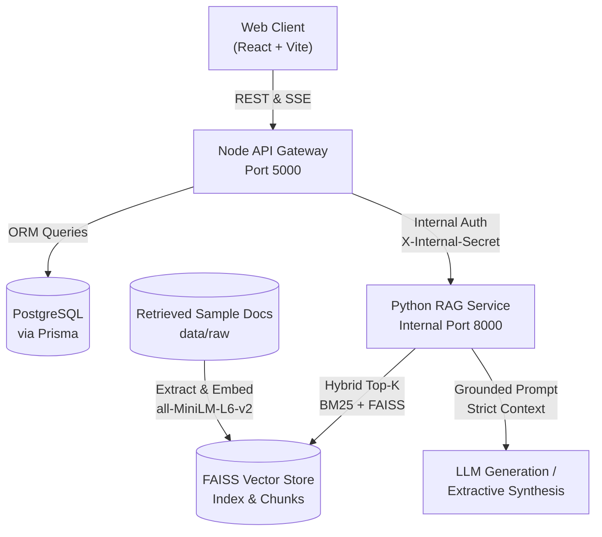

# Traffic Rules and Fines Assistant Using Generative AI (GenAI + RAG)

A full-stack, enterprise-grade Traffic Rules and Fines Assistant built with **React 18 + Vite + TypeScript** frontend, **Node.js (Express + TypeScript + Prisma + PostgreSQL)** API gateway, and **Python (FastAPI + FAISS + Groq)** AI microservice, strictly grounded in official traffic laws with transparent source citations.

---

## Architecture Overview



---

## Key Features

1. **Strict Legal Grounding**: Answers are derived exclusively from verified legal documents. The system never guesses or hallucinates penalties. If context is missing, it provides a safe fallback alerting the user to official transport portals.
2. **Transparent Citations & Source Drawer**: Every assistant answer highlights the exact Section, Document Title, and Gazette reference. Clicking any source citation opens an inspection drawer showing the exact statutory text chunk.
3. **Fines Quick Lookup**: Dynamic violation lookup engine powered by RAG vector retrieval without hard-coded numbers.
4. **Knowledge Base Explorer**: Interactive directory of all indexed acts, rules, and notifications with metadata and effective dates.
5. **Secure Admin Ingestion**: JWT-authenticated portal with drag-and-drop document upload (PDF/TXT), live chunk status, full re-indexing, and query analytics.
6. **Shared Secret Internal Security**: Internal Gateway-to-AI-service calls are authenticated via `X-Internal-Secret` header.

---

## Monorepo Layout

```
├── apps/
│   ├── web/             # React 18 + Vite + Tailwind CSS + Framer Motion
│   ├── api/             # Node.js + Express + TypeScript + Prisma Gateway
│   └── ai-service/      # Python 3.11 + FastAPI + FAISS + Groq RAG Engine
├── data/
│   ├── raw/             # Official verified documents (.txt, .pdf)
│   ├── processed/       # Extracted text chunks
│   └── index/           # FAISS index and metadata store
├── tests/
│   ├── eval/            # 100-query evaluation benchmark suite
│   ├── e2e/             # Playwright end-to-end tests
│   └── test_rag.py      # Python RAG unit tests
├── docker-compose.yml   # Multi-service container orchestration
├── .env.example         # Environment template
└── README.md
```

---

## Quickstart (Local Development)

### 1. Environment Setup
Copy `.env.example` to `.env`:
```bash
cp .env.example .env
```
Set your `GROQ_API_KEY` in `.env` (optional for local testing; extractive synthesis is active out-of-the-box).

### 2. Start Python AI Microservice
```bash
cd apps/ai-service
python -m pip install -r requirements.txt
python app/cli.py           # Index retrieved sample documents from data/raw/
python app/main.py          # Starts FastAPI on http://localhost:8000
```

### 3. Start Node.js API Gateway & Provision Admin
```bash
cd apps/api
npm install
npx prisma generate
npm run dev                 # Starts Express on http://localhost:5000
```

In a separate terminal, provision the initial administrator account (zero hardcoded credentials exist):
```bash
npm run admin:create
```
Enter your official email and a strong password (minimum 12 characters). It will be hashed using Argon2id.

### 4. Start React Web Client
```bash
cd apps/web
npm install
npm run dev                 # Starts Vite on http://localhost:5173
```

---

## Prerequisites Before Real / Production Use

> [!CRITICAL]
> The current system evaluation and demonstration are executed on **synthetic sample test documents, not verified official law**.

Before public launch or formal legal reference:
1. **Load Official Gazettes:** Download verified, official gazette copies of the Motor Vehicles (Amendment) Act, Central Motor Vehicles Rules (CMVR), and state-specific compounding schedules from [MoRTH](https://morth.nic.in) or state transport departments into `data/raw/`.
2. **Mark Documents as Verified in Admin Portal:** Log in to `/admin`, inspect each uploaded legal gazette, and toggle its status to **Verified** (clearing the `isTestData` warning flag).
3. **Re-Run Evaluation Benchmark:** Run `python tests/eval/run_eval.py` against the newly indexed official documents to confirm hit rates ($\ge 90\%$) and zero hallucinations.
4. **Review Legal Disclaimer:** Have qualified legal counsel review the public disclaimers on the landing page, chat interface, and `/privacy` page.

---

## Admin Account Provisioning
Admin accounts are provisioned exclusively via the secure interactive CLI tool:
```bash
npm run admin:create
```
- Prompts interactively for official email and secure password (minimum 12 characters).
- Hashes password with cryptographic Argon2id algorithm.
- No default or seeded admin accounts exist.

---

## Testing & Quality Assurance

### Run All Test Suites
- **Python RAG Core (27 tests):** `python -m pytest tests/test_rag.py -v`
- **React Frontend (17 tests):** `npm run test:web`
- **Node.js API Gateway (49 tests):** `npm run test:api`
- **Full Type Check & Linting:** `npm run lint`

### Run Evaluation Suite (Hit-Rate & Anti-Hallucination)
```bash
python tests/eval/run_eval.py
```

### Run Playwright E2E Tests
```bash
npx playwright test
```

---

## PRD Specification Section Mapping

- **Section 6 (Pages and Flows):** React 18 frontend with Landing, Chat with SSE streaming & source drawer, Fines directory, Knowledge Explorer, Admin Auth, and Admin Ingestion Dashboard.
- **Section 11 (API Spec):** Express gateway exposing `/api/v1/health`, `/api/v1/chat`, `/api/v1/fines/search`, `/api/v1/documents`, `/api/v1/meta/filters`, `/api/v1/feedback`, `/api/v1/auth/*`, and `/api/v1/admin/*`.
- **Section 13 (Data Model):** Prisma ORM schema with PostgreSQL persistence (`User`, `RefreshToken`, `AuditLog`, `Document`, `ChatSession`, `Message`, `Feedback`, `QueryLog`).
- **Section 16 (Testing):** Automated Jest unit/integration suite (49 tests), Pytest RAG suite (27 tests), Vitest web suite (17 tests), and Playwright axe accessibility audit.
- **Section 18 (Milestones):** Six sequential delivery phases covering RAG core, API gateway, React UI, search & citations, admin security, and hardening.
- **Section 19 (Acceptance):** Seven original PRD criteria evaluated end-to-end.

---

## Containerization & CI Status

- **Docker:** `docker-compose up` is unverified on this host (Docker daemon not installed in local environment).
- **CI / CD:** CI has never run (repository has not been pushed to a remote GitHub Actions runner).
