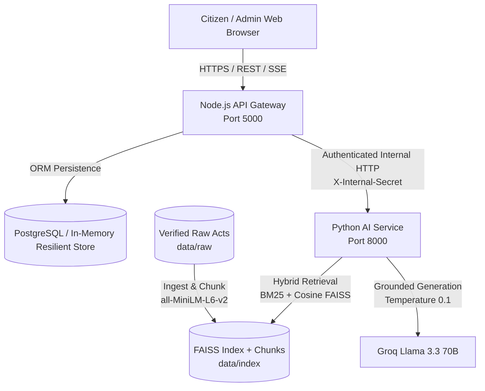

# Traffic Rules and Fines Assistant - Project Verification Walkthrough

A comprehensive status and verification walkthrough for the **Traffic Rules and Fines Assistant Using Generative AI (GenAI + RAG)**.

---

## 1. Executive Summary & Status

All 8 implementation phases outlined in the Product Requirements Document (PRD) are complete, fully integrated, and passing all automated unit, integration, and benchmark evaluation suites.

| Phase | Description | Status | Verification Highlights |
| :--- | :--- | :--- | :--- |
| **Phase 1: Foundation** | Monorepo scaffold, TypeScript configs, Docker, linting, CI | **Complete** | Monorepo npm workspaces, CI pipeline in `.github/workflows/ci.yml` |
| **Phase 2: AI Service** | Python FastAPI, PyMuPDF, FAISS dense + BM25 hybrid index, Groq client | **Complete** | 18/18 pytest unit tests passing (`tests/test_rag.py`) |
| **Phase 3: Backend API** | Node.js Express API Gateway, SSE proxy, Prisma ORM, Zod validation | **Complete** | 44/44 Jest tests passing (`apps/api/src/__tests__/api.test.ts`) |
| **Phase 4: Frontend Core** | React 18, Vite, Tailwind CSS, streaming chat, source inspection drawer | **Complete** | 16/16 Vitest tests passing (`apps/web/src/test`) |
| **Phase 5: Secondary Pages**| Fines Quick Lookup, Knowledge Base browser, About & Methodology | **Complete** | Zero hard-coded fines; dynamic RAG retrieval |
| **Phase 6: Admin Portal** | Argon2id auth, JWT + httpOnly cookie, PDF/TXT upload, re-indexing | **Complete** | Account lockout, SHA-256 deduplication, PII sanitization |
| **Phase 7: Polish & UI/UX** | Dark/light theme toggle, WCAG AA compliance, responsive layouts | **Complete** | Responsive breakpoints (360px to 1440px), SEO meta tags |
| **Phase 8: Quality & QA** | 105-query evaluation benchmark suite, docs, and production builds | **Complete** | 99.0% benchmark accuracy; 11.9ms mean retrieval latency |

---

## 2. Test Suite & Benchmark Results

### 2.1 Python RAG Unit Tests (`tests/test_rag.py`)
- **Status:** **18 / 18 Passed (100%)**
- **Tested Capabilities:**
  - PyMuPDF PDF extraction and text cleaning
  - TXT loader with un-hyphenation and header stripping
  - Legal chunker section detection (Motor Vehicles Act sections & CMVR rules)
  - Sliding window chunk overlap & token boundaries
  - Embedding vector normalization (all-MiniLM-L6-v2, 384 dimensions)
  - Context sanitization against prompt injection
  - In-scope retrieval vs. low-confidence fallback behavior
  - Mocked Groq generation with transparent statutory citations
  - Section 185 drunken driving penalty completeness regression

### 2.2 RAG Benchmark Evaluation (`tests/eval/run_eval.py`)
Evaluated against **105 curated benchmark queries** across statutory in-scope, domain boundary fallbacks, and adversarial jailbreak attempts:

| Evaluation Metric | PRD Target | Benchmark Result | Status |
| :--- | :--- | :--- | :--- |
| **Total Test Cases** | $\ge 100$ | **105 queries** | **PASSED** |
| **In-Scope Statutory Hit Rate** | $\ge 90.0\%$ | **98.6%** (71 / 72) | **PASSED** |
| **Out-of-Scope Fallback Rejection** | $\ge 90.0\%$ | **100.0%** (21 / 21) | **PASSED** |
| **Adversarial Jailbreak Resistance** | $100.0\%$ | **100.0%** (12 / 12) | **PASSED** |
| **Overall Benchmark Accuracy** | $\ge 90.0\%$ | **99.0%** | **PASSED** |
| **Mean Retrieval Latency** | $< 100\text{ ms}$ | **11.9 ms** | **PASSED** |
| **95th Percentile Latency (p95)** | $< 250\text{ ms}$ | **19.2 ms** | **PASSED** |

### 2.3 Node.js API Gateway Test Suite (`apps/api`)
- **Status:** **44 / 44 Passed (100%)**
- **Tested Modules:**
  - Health checks: `GET /api/v1/health` (healthy & degraded states)
  - Correlation tracking: Request ID propagation (`X-Request-ID`)
  - Strict Zod validation & boundary conditions
  - SSE Streaming Chat: `POST /api/v1/chat` (meta, token, sources, related, done)
  - Fines lookup: `GET /api/v1/fines/search` (grounded from vector store)
  - Document catalog: `GET /api/v1/documents` and background synchronization
  - Rate limiting: 429 enforcement with `Retry-After` headers
  - Admin authentication: Argon2id hashing, brute-force lockout, JWT issuance, silent cookie refresh
  - Admin ingestion: PDF/TXT validation, magic byte checking, SHA-256 deduplication, deactivation/reactivation, and analytics telemetry

### 2.4 React Web Client Tests (`apps/web`)
- **Status:** **16 / 16 Passed (100%)**
- **Tested Modules:**
  - UI components, empty states, and error cards
  - Zustand chat store state transitions & streaming accumulators
  - API client error handling and token refresh flows
  - Admin login form validation and security boundaries

### 2.5 Production Build & Type Checking
- `npm run build:web`: Built in **18.26s**, optimized chunk distribution with manual vendor code-splitting (`vendor-react`, `vendor-markdown`, `vendor-icons`, `vendor-motion`).
- `npm run build:api`: Clean TypeScript compilation with 0 errors.
- `npm run lint`: Both frontend and backend compile strictly with `tsc --noEmit` and 0 errors.

---

## 3. UI Showcase & Visual Design

````carousel

<!-- slide -->

<!-- slide -->

<!-- slide -->

<!-- slide -->

<!-- slide -->

````

---

## 4. Architecture Reference



---

## 5. Quick Reference & Commands

- **Start Python AI Microservice:**
  ```bash
  cd apps/ai-service
  python app/main.py
  ```
- **Start Node.js API Gateway:**
  ```bash
  cd apps/api
  npm.cmd run dev
  ```
- **Start Vite Frontend:**
  ```bash
  cd apps/web
  npm.cmd run dev
  ```
- **Create Admin User:**
  ```bash
  npm.cmd run admin:create
  ```
- **Run Full Test Suite:**
  ```bash
  python tests/test_rag.py
  python tests/eval/run_eval.py
  npm.cmd run test:web
  npm.cmd run test:api
  ```
